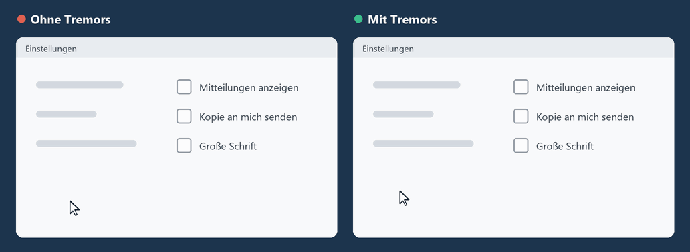

# Tremors

**Eine ruhige Maus für zitternde Hände.**
Kostenlos, Open Source und datenschutzfreundlich. Ein kleines Programm für Windows.

[**Tremors.exe herunterladen**](https://github.com/JeroenJonckheer/Tremors/releases/latest)

[English](README.md) · [Nederlands](README.nl.md) · [Français](README.fr.md) · **Deutsch**

---

Dieselbe zitternde Hand: links so, wie Windows sie sieht, rechts durch den Filter von Tremors.

Mit dem Alter lässt die Feinmotorik nach, während wir den Computer so dringend brauchen
wie eh und je. Eine zitternde Hand lässt den Mauszeiger wackeln, Klicks landen neben der
Schaltfläche und die Seite scrollt versehentlich.

Tremors sitzt unauffällig in der Ecke des Bildschirms und filtert das Zittern aus jeder
Mausbewegung, noch bevor Windows sie sieht. Kleine, zitternde Bewegungen werden
abgefangen. Gewollte Bewegungen gehen genau dorthin, wo Sie sie haben wollen.

Tremors wurde für Nico entwickelt, damit er seinen Computer weiter benutzen kann. Es ist
kostenlos für alle, die dasselbe brauchen.

## Was es tut

- **Hält den Mauszeiger ruhig.** Zittern und plötzliche Ruckler werden herausgefiltert;
  wer auf einer Schaltfläche stillhält, hält auch den Zeiger still.
- **Hält an, wenn Sie anhalten.** Sobald die Hand stillsteht oder klickt, steht auch der
  Zeiger still. Er schießt nicht über die Schaltfläche hinaus.
- **Ignoriert versehentliche Klicks** (optional). Ein Klick zählt erst, wenn die Taste kurz
  gehalten wird; ein zitterndes Antippen wird ignoriert. Ziehen und Doppelklicken
  funktionieren weiterhin.
- **Bei Zittern langsamer** (optional). Zittert die Hand, bewegt sich der Zeiger langsamer,
  sodass das Zittern auf dem Bildschirm kleiner wirkt. Gerade Bewegungen bleiben gleich schnell.
- **Hält das Mausrad ruhig.** Ein zitterndes Hin und Her wird ignoriert, damit eine Seite
  nicht auf und ab springt.
- **Einfach einzustellen.** Ein Regler für die Stärke und ein paar weitere zur Feinabstimmung.
- **Spricht Ihre Sprache.** Deutsch, Niederländisch, Englisch oder Französisch. Folgt
  Windows, oder wählen Sie eine Flagge im Einstellungsfenster.
- **Sonst nichts.** Kein Konto, kein Internet, keine Werbung, keine Datensammlung.

## Installation

1. Laden Sie [**Tremors.exe**](https://github.com/JeroenJonckheer/Tremors/releases/latest) herunter.
2. Legen Sie die Datei an einem festen Ort ab, zum Beispiel in `Dokumente` oder in `C:\Program Files\Tremors`.
3. Doppelklicken Sie darauf. Das Einstellungsfenster öffnet sich und die Maus wird sofort
   ruhig gehalten. Neben der Uhr erscheint ein rundes blaues Symbol mit einem Mauszeiger.
4. Aktivieren Sie **Mit Windows starten**, damit es immer läuft. Windows startet Tremors dann
   bei jeder Anmeldung unauffällig; Sie sehen nur das Symbol neben der Uhr.

Eine Installation ist nicht nötig: keine Administratorrechte und kein .NET erforderlich.

> **Windows kann beim ersten Start warnen** („Der Computer wurde durch Windows geschützt“).
> Tremors ist nicht mit einem kostenpflichtigen Zertifikat signiert. Klicken Sie auf
> **Weitere Informationen** → **Trotzdem ausführen**. Sie können den Download mit der Datei
> `Tremors.exe.sha256` auf der Release-Seite prüfen, und der gesamte
> [Quellcode](src/Tremors) ist hier einsehbar.

## Bedienung

| Wo | Was |
|---|---|
| **Linksklick** auf das Symbol | Öffnet das Einstellungsfenster |
| `Tremors.exe` erneut starten | Öffnet ebenfalls das Einstellungsfenster |
| **Rechtsklick** auf das Symbol | Menü: **Aktiv** (ein/aus), **Einstellungen**, **Mit Windows starten**, **Tremors beenden** |
| Blaues Symbol | Tremors hält die Maus ruhig |
| Graues Symbol | Tremors ist pausiert |

Das Einstellungsfenster:

| Einstellung | Bedeutung |
|---|---|
| **Stärke** (0-100) | Wie viel Zittern herausgefiltert wird. Beginnen Sie mit 70. Zittert der Zeiger noch, erhöhen Sie den Wert; fühlt sich die Maus träge an, senken Sie ihn. 0 schaltet den Filter aus. |
| **Ruhezone** (0-30 px) | Der Zeiger bleibt stehen, bis sich die Hand weiter als diese Strecke bewegt. Erhöhen Sie sie, wenn der Zeiger noch springt, während Sie auf einer Schaltfläche stillzuhalten versuchen. |
| **Zum Klicken halten** (0-500 ms) | Ein Klick zählt erst, wenn die Taste so lange gedrückt wird; kürzeres Antippen wird ignoriert. 0 = aus. Versuchen Sie 100-200 ms, wenn versehentlich geklickt wird. |
| **Bei Zittern verlangsamen** | Zittert die Hand, bewegt sich der Zeiger langsamer, sodass das Zittern auf dem Bildschirm kleiner wirkt. Gerade Bewegungen bleiben gleich schnell. Ist das Häkchen gesetzt, stellt ein Regler ein, wie viel langsamer (0-90 %, beginnen Sie mit 60 %). Standardmäßig aus. |
| Flaggen (oben rechts) | Sprache von Tremors. |
| **Mausrad stabilisieren** | Ignoriert ein Scrollen in die Gegenrichtung direkt nach einem Scrollen; das ist meistens ein Zittern. |
| **Mit Windows starten** | Startet Tremors automatisch bei der Anmeldung. |

Jede Änderung wirkt sofort und wird gespeichert.

Solange Tremors aktiv ist, schaltet es die Mausbeschleunigung von Windows aus
(„Zeigerbeschleunigung verbessern“), weil sie schnelle, zitternde Bewegungen vergrößert.
Ihre eigene Einstellung kehrt zurück, sobald Tremors pausiert oder beendet wird.

**Die richtigen Einstellungen finden:** Beginnen Sie mit Stärke 70. Kommen noch Ruckler
durch? Aktivieren Sie zuerst „Bei Zittern verlangsamen“, erhöhen Sie dann die Ruhezone und erst
danach die Stärke. Wählen Sie die niedrigsten Werte, bei denen der Zeiger ruhig bleibt;
so reagiert die Maus so direkt wie möglich.

### Tipps für Pflegende und Angehörige

- Einmal einrichten, **Mit Windows starten** aktivieren, und wer den Computer benutzt,
  muss nie mehr daran denken.
- Eine schwere Maus oder ein Trackball hilft ebenfalls; Tremors funktioniert mit beiden.
- Größerer Text (Einstellungen → Barrierefreiheit → Textgröße) und ein größerer Mauszeiger
  (Einstellungen → Barrierefreiheit → Mauszeiger und Toucheingabe) machen Schaltflächen
  leichter erreichbar.

## Datenschutz

Tremors liest Mausbewegungen, um sie zu filtern, und sonst nichts. Es liest keine
Tastatureingaben, speichert oder sendet nichts und verbindet sich nie mit dem Internet.
Die einzige Datei, die es schreibt, sind seine Einstellungen: `%AppData%\Tremors\settings.json`.

## Einschränkungen

- Windows 10 und 11, 64 Bit.
- Auf dem Anmeldebildschirm von Windows und in der Abfrage „Möchten Sie zulassen, dass
  durch diese App…“ (UAC) funktioniert es nicht; dort lässt Windows kein Programm zu.
- In Fenstern, die als Administrator laufen, kann die Bewegung ungefiltert sein, es sei
  denn, Tremors läuft ebenfalls als Administrator.
- Spiele, die die Maus direkt auslesen (Raw Input), werden nicht gefiltert.

## Selbst kompilieren

Siehe die [englische README](README.md#build-from-source).

## Lizenz

[MIT](LICENSE): frei zu nutzen, weiterzugeben und zu verändern, auch kommerziell.
Tremors ist und bleibt kostenlos.
