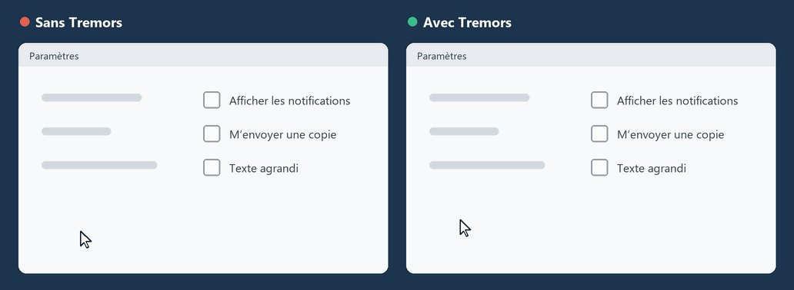

# Tremors

**Une souris stable pour les mains qui tremblent.**
Gratuit, open source et respectueux de la vie privée. Un petit programme pour Windows.

[**Télécharger Tremors.exe**](https://github.com/JeroenJonckheer/Tremors/releases/latest)

[English](README.md) · [Nederlands](README.nl.md) · **Français** · [Deutsch](README.de.md)

---

La même main tremblante : à gauche telle que Windows la voit, à droite à travers le filtre de Tremors.

Avec l’âge, la motricité fine diminue, alors que nous avons toujours autant besoin de
l’ordinateur. Une main qui tremble fait trembler le curseur, les clics tombent à côté du
bouton et la page défile par accident.

Tremors se tient discrètement dans un coin de l’écran et filtre le tremblement de chaque
mouvement de la souris, avant même que Windows ne le voie. Les petits mouvements
tremblants sont absorbés. Les mouvements volontaires vont exactement là où vous le voulez.

Tremors a été créé pour Nico, afin qu’il puisse continuer à utiliser son ordinateur. Il est
gratuit pour tous ceux qui en ont besoin.

## Ce qu’il fait

- **Stabilise le curseur.** Les tremblements et les secousses soudaines sont filtrés ; quand
  vous restez immobile sur un bouton, le curseur reste immobile aussi.
- **Les clics restent sur leur cible.** Au moment du clic, le curseur cesse de glisser.
- **Ignore les clics involontaires** (facultatif). Un clic ne compte que si le bouton est
  maintenu un instant ; une pression tremblante est ignorée. Le glisser-déposer et le
  double-clic fonctionnent normalement.
- **Stabilise la molette.** Un va-et-vient tremblant est ignoré, la page ne saute plus.
- **Simple à régler.** Un curseur pour l’intensité, et quelques autres pour affiner.
- **Parle votre langue.** Français, néerlandais, anglais ou allemand. Suit Windows, ou
  choisissez un drapeau dans la fenêtre des paramètres.
- **Rien d’autre.** Pas de compte, pas d’internet, pas de publicité, aucune collecte de données.

## Installation

1. Téléchargez [**Tremors.exe**](https://github.com/JeroenJonckheer/Tremors/releases/latest).
2. Placez le fichier à un endroit fixe, par exemple dans `Documents` ou dans `C:\Program Files\Tremors`.
3. Double-cliquez dessus. Une icône ronde bleue avec un pointeur de souris apparaît près
   de l’horloge, et la souris est immédiatement stabilisée.
4. Cliquez sur l’icône et cochez **Démarrer avec Windows** pour qu’il soit toujours actif.

Aucune installation n’est nécessaire : ni droits d’administrateur, ni .NET.

> **Windows peut afficher un avertissement la première fois** (« Windows a protégé votre
> ordinateur »). Tremors n’est pas signé avec un certificat payant. Cliquez sur
> **Informations complémentaires** → **Exécuter quand même**. Vous pouvez vérifier le
> téléchargement avec le fichier `Tremors.exe.sha256` de la page de publication, et tout
> le [code source](src/Tremors) est consultable ici.

## Utilisation

| Où | Quoi |
|---|---|
| **Clic gauche** sur l’icône | Ouvre la fenêtre des paramètres |
| Relancer `Tremors.exe` | Ouvre aussi la fenêtre des paramètres |
| **Clic droit** sur l’icône | Menu : **Activé** (marche/arrêt), **Paramètres**, **Démarrer avec Windows**, **Quitter Tremors** |
| Icône bleue | Tremors stabilise la souris |
| Icône grise | Tremors est en pause |

La fenêtre des paramètres :

| Paramètre | Signification |
|---|---|
| **Intensité** (0-100) | La quantité de tremblement filtrée. Commencez à 70. Le curseur tremble encore ? Augmentez. La souris semble lente ? Diminuez. 0 désactive le filtre. |
| **Vitesse du pointeur** (10-100 %) | La distance parcourue par le curseur pour un mouvement de la main. Plus bas, le tremblement paraît plus petit à l’écran ; il faut alors déplacer la souris un peu plus. Essayez 50-70 % pour un tremblement fort. |
| **Zone d’immobilité** (0-30 px) | Le curseur ne bouge pas tant que la main reste dans cette distance. Augmentez-la si le curseur saute encore quand vous essayez de rester sur un bouton. |
| **Maintenir pour cliquer** (0-500 ms) | Un clic ne compte que si le bouton est maintenu aussi longtemps ; les pressions plus courtes sont ignorées. 0 = désactivé. Essayez 100-200 ms en cas de clics involontaires. |
| Drapeaux (en haut à droite) | Langue de Tremors. |
| **Stabiliser la molette** | Ignore un défilement en sens inverse juste après un défilement ; c’est généralement un tremblement. |
| **Démarrer avec Windows** | Lance Tremors automatiquement à l’ouverture de session. |

Chaque modification s’applique immédiatement et est mémorisée.

Tant que Tremors est actif, il désactive l’accélération de la souris de Windows
(« Améliorer la précision du pointeur »), car elle amplifie les mouvements rapides et
tremblants. Votre propre réglage est rétabli dès que Tremors est mis en pause ou fermé.

**Trouver les bons réglages :** commencez avec l’intensité 70. Des secousses passent
encore ? Baissez d’abord la vitesse du pointeur, puis augmentez la zone d’immobilité, et
seulement ensuite l’intensité. Choisissez les valeurs les plus basses qui gardent le
curseur calme ; la souris reste ainsi aussi réactive que possible.

### Conseils pour les aidants et la famille

- Configurez-le une fois, cochez **Démarrer avec Windows**, et la personne qui utilise
  l’ordinateur n’aura plus jamais à y penser.
- Une souris lourde ou un trackball aide aussi ; Tremors fonctionne avec les deux.
- Un texte plus grand (Paramètres → Accessibilité → Taille du texte) et un pointeur plus
  grand (Paramètres → Accessibilité → Pointeur de la souris et tactile) rendent les
  boutons plus faciles à atteindre.

## Vie privée

Tremors lit les mouvements de la souris pour les filtrer, et rien d’autre. Il ne lit pas
le clavier, n’enregistre et n’envoie rien et ne se connecte jamais à internet. Le seul
fichier qu’il écrit, ce sont ses paramètres : `%AppData%\Tremors\settings.json`.

## Limites

- Windows 10 et 11, 64 bits.
- Il ne fonctionne pas sur l’écran de connexion de Windows ni dans la fenêtre « Voulez-vous
  autoriser cette application… » (UAC) ; Windows n’y autorise aucun programme.
- Dans les fenêtres exécutées en tant qu’administrateur, le mouvement peut ne pas être
  filtré, sauf si Tremors est lui aussi exécuté en tant qu’administrateur.
- Les jeux qui lisent la souris directement (raw input) ne sont pas filtrés.

## Compiler soi-même

Voir le [README en anglais](README.md#build-from-source).

## Licence

[MIT](LICENSE) : libre d’utiliser, de partager et de modifier, y compris à des fins
commerciales. Tremors est et restera gratuit.
