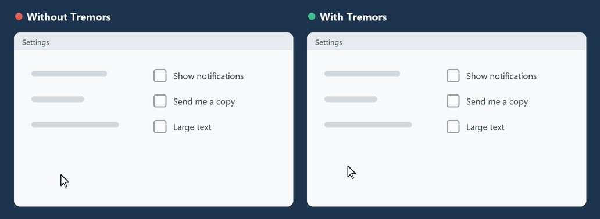

<div align="center">


# Tremors

**A calm mouse for shaky hands.**
Free, open source and private. One small program for Windows.

[](https://github.com/JeroenJonckheer/Tremors/actions/workflows/ci.yml)
[](https://github.com/JeroenJonckheer/Tremors/releases/latest)
[](LICENSE)

[**Download Tremors.exe**](https://github.com/JeroenJonckheer/Tremors/releases/latest) · [How it works](docs/how-it-works.md)

**English** · [Nederlands](README.nl.md) · [Français](README.fr.md) · [Deutsch](README.de.md)

</div>

---

<p align="center"></p>
<p align="center"><sub>The same trembling hand, left as Windows sees it, right through the Tremors filter.
Both paths are computed by the real filter; see <a href="tools/make_demo_gif.py">tools/make_demo_gif.py</a>.</sub></p>

As we age, our fine motor skills may decline, while our reliance on computers remains
as strong as ever. A trembling hand makes the cursor shake, clicks land next to the
button and the page scrolls by accident.

Tremors sits quietly in the corner of the screen and filters the trembling out of
every mouse movement before Windows sees it. Small, shaky movements are absorbed.
Deliberate movements still go where you want them to go.

Tremors was built for Nico, so he could keep using his computer. It is free for
everyone who needs the same.

## What it does

- **Steadies the cursor.** Trembling and sudden jerks are smoothed away; holding still on a button
  keeps the cursor still.
- **Stops where you stop.** The moment the hand stops or clicks, the cursor stops too. It
  does not drift past the button.
- **Ignores accidental clicks** (optional). A click only counts when the button is held
  a moment; a trembling tap is ignored. Dragging and double-clicking still work.
- **Slows down when shaking** (optional). While the hand trembles, the cursor moves
  slower, so the tremor looks smaller on screen. Straight movements keep their speed.
- **Steadies the scroll wheel.** A trembling flick back and forth is ignored, so a
  page does not jump up and down.
- **Simple to set up.** One slider for the strength, a few options for fine-tuning.
- **Speaks your language.** English, Dutch, French or German. It follows Windows, or
  pick a flag in the settings window.
- **Nothing else.** No account, no internet, no ads, no data collection.

## Install

1. Download [**Tremors.exe**](https://github.com/JeroenJonckheer/Tremors/releases/latest).
2. Put it somewhere permanent, for example in `Documents` or `C:\Program Files\Tremors`.
3. Double-click it. The settings window opens and the mouse is steadied right away. A round
   blue icon with a mouse pointer appears next to the clock.
4. Tick **Start with Windows**, so it is always on. Windows then starts Tremors quietly at
   every sign-in; you only see the icon next to the clock.

No installation, no administrator rights and no .NET download are needed.

> **Windows may warn you the first time** ("Windows protected your PC"). Tremors is
> not signed with a paid certificate. Click **More info** → **Run anyway**. You can
> verify the download with the `Tremors.exe.sha256` file on the release page, and
> the [source code](src/Tremors) is all here to read.

## Use

| Where | What |
|---|---|
| **Left-click** the icon | Opens the settings window |
| Start `Tremors.exe` again | Also opens the settings window |
| **Right-click** the icon | Menu: **Active** (on/off), **Settings**, **Start with Windows**, **Quit** |
| Blue icon | Tremors is steadying the mouse |
| Grey icon | Tremors is paused |

The settings window:

| Setting | Meaning |
|---|---|
| **Strength** (0-100) | How much trembling is filtered. Start at 70. Raise it if the cursor still shakes; lower it if the mouse feels slow. 0 turns the filter off. |
| **Still zone** (0-30 px) | The cursor stays put until the hand moves further than this. Raise it if the cursor still jumps when you try to hold still on a button. |
| **Hold to click** (0-500 ms) | A click only counts when the button is held this long; shorter taps are ignored. 0 = off. Try 100-200 ms if clicks happen by accident. |
| **Slow down when shaking** | While the hand trembles, the cursor moves slower, so the tremor looks smaller on screen. Straight movements keep their speed. When ticked, a slider sets how much slower (0-90%, 60% to start). Off by default. |
| Flags (top right) | Interface language. |
| **Steady scroll wheel** | Ignores a scroll in the opposite direction right after a scroll, which is usually a tremor. |
| **Start with Windows** | Starts Tremors automatically when you sign in. |

Every change takes effect immediately and is remembered.

While Tremors is on, it switches off the Windows mouse acceleration ("Enhance pointer
precision"), because acceleration makes fast trembling movements larger. Your own
setting returns as soon as Tremors is paused or closed.

**Finding the right settings:** start with strength 70. Shakes still come through?
Tick slow down when shaking first, then raise the still zone, then the strength. Pick the
lowest values that keep the cursor calm, so the mouse stays as direct as possible.

### Tips for helpers and family

- Set it up once, tick **Start with Windows**, and the person using the computer
  never has to think about it.
- A heavy mouse or a trackball helps as well; Tremors works with both.
- Large Windows text (Settings → Accessibility → Text size) and a larger mouse pointer
  (Settings → Accessibility → Mouse pointer) make targets easier to hit.

## Privacy

Tremors reads mouse movement to filter it, and that is all. It does not read the
keyboard, it does not save or send anything, and it never connects to the internet.
The only file it writes is its settings: `%AppData%\Tremors\settings.json`.

## Limitations

- Windows 10 and 11, 64-bit.
- It cannot steady the mouse on the Windows sign-in screen or in the "Do you want to
  allow this app" (UAC) prompt; Windows does not allow any program there.
- Windows that run as administrator may get unfiltered movement unless Tremors also
  runs as administrator.
- Games that read the mouse directly (raw input) are not filtered.

## Build from source

Requires the [.NET 8 SDK](https://dotnet.microsoft.com/download/dotnet/8.0).

```
dotnet test                                      # build and run the tests
dotnet run --project src/Tremors                 # run it
dotnet publish src/Tremors -c Release            # dist\Tremors.exe, a single file
```

How the filter works is explained in [docs/how-it-works.md](docs/how-it-works.md).
Contributions are welcome; see [CONTRIBUTING.md](CONTRIBUTING.md).

## License

[MIT](LICENSE): free to use, share and change, also commercially.
Tremors is and will remain free.
